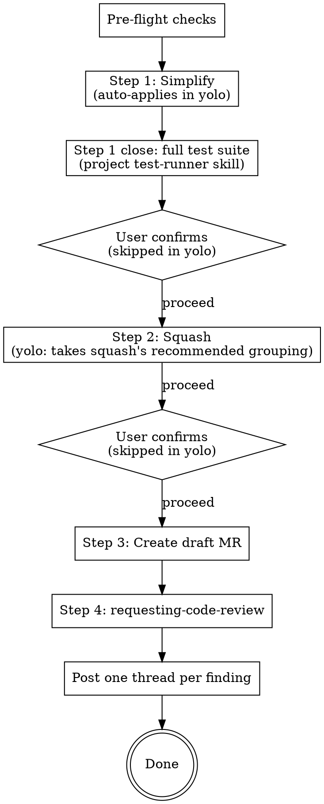

# Finalize Branch

## Overview

Chains four post-implementation steps: simplify, squash, draft MR, code review posted on that MR. Clean it, squash it, open it, review it.

The review findings go up unchecked, one thread per finding, on your own draft MR. Nothing here decides which to fix. Battle Station's My merge requests page treats a comment of yours that nobody answered as a thread waiting on you: Draft answers checks each one, and you pick fix, reply or ticket there.

**Announce at start:** "I'm using the finalize-branch skill to simplify, squash, open a draft MR, and post the review findings on it." In yolo mode add: "Running in **yolo** mode: simplify and squash apply without confirmation gates."

## Arguments

One optional argument — the literal text after `/finalize-branch`.

| Arg | Effect |
|---|---|
| _(none)_ | **Gated mode** (default). User confirms between Steps 1→2 and 2→3. |
| `yolo` (also `--yolo`, `auto`, `-y`) | **Yolo mode.** Both gates are removed. |

Match case-insensitively against `^(yolo|--yolo|auto|-y)$`. Anything else → ask what was meant.

**Yolo does not change:** pre-flight checks; the target-branch question in Step 3a; the `squash` sub-skill's diff-verification and base-branch question.

## Config

Optional `AI_SKILLS_*` env vars; recommended setup is one line in `~/.zshenv`:

```sh
[ -f ~/.config/ai-skills/config.env ] && source ~/.config/ai-skills/config.env
```

Commands below use `${VAR:-default}` inline.

| Variable | Default | Purpose |
|---|---|---|
| `AI_SKILLS_MR_TOOL` | `gh` | `gh` (GitHub) or `glab` (GitLab) |
| `AI_SKILLS_REVIEWERS` | _(empty)_ | Comma-separated reviewer handles. Empty → no `--reviewer` flag |
| `AI_SKILLS_TARGET_BRANCH` | `main` | Target branch for the MR/PR |
| `AI_SKILLS_TICKET_PREFIX` | _(empty)_ | Ticket prefix (e.g. `PROJ`). Empty → match any uppercase slug |

## Pre-flight Checks

All three must pass; stop otherwise.

```bash
TARGET="${AI_SKILLS_TARGET_BRANCH:-main}"

# 1. Not on the target branch
[ "$(git branch --show-current)" = "$TARGET" ] && echo "STOP: on $TARGET" && exit 1

# 2. Clean working tree
git status --porcelain | grep -q . && echo "STOP: uncommitted changes" && exit 1

# 3. Has commits ahead of the target branch
git fetch origin "$TARGET" --quiet
MERGE_BASE=$(git merge-base "origin/$TARGET" HEAD)
[ "$(git rev-parse HEAD)" = "$MERGE_BASE" ] && echo "STOP: no commits ahead of $TARGET" && exit 1
```

## The Process



### Step 1: Simplify

**REQUIRED SUB-SKILL:** `simplify` (code-simplifier agent) if available. It proposes clarity/consistency improvements on the branch's recently modified code.

**Gated:** present the proposals; the user approves or rejects each; commit the approved ones; **GATE** before Step 2.

**Yolo:** apply everything the simplifier returns; print a short summary (file + one line per change); commit `refactor: simplify per code-simplifier`; proceed to Step 2 in the same turn.

**Step 1 close — full test suite, once.** After the last Step 1 commit and before
the gate, run the project's full suite through its test-runner skill
(`pytest-docker` Tier 2 where that skill is installed; otherwise the project's
documented full-suite command). This is the branch's single local full-suite
run: implementers run only targeted tests, and nothing between tasks does, so
this is where a cross-cutting break surfaces before the MR round-trip. Fix
failures, commit, re-run once; the squash in Step 2 folds the fix. Every failure
on the branch is the branch's own. In yolo the run still happens — only the gate is skipped.

### Step 2: Squash

**REQUIRED SUB-SKILL:** `squash`

**Gated:** invoke `squash` plainly — it presents its grouping and waits. **Yolo:** invoke `squash yolo` — it prints the recommendation and executes it without waiting. Its diff-verification and base-branch question are safety, not approval: never overridden, yolo included. Its Step 5 test run fires only after a squash with hand-resolved conflicts; otherwise the Step 1-close run stands and the squash report says so.

**Gated:** after squash, **GATE** before Step 3. **Yolo:** proceed to Step 3 in the same turn.

### Step 3: Create MR

One path for GitHub and GitLab; only the final create/update command differs on `${AI_SKILLS_MR_TOOL:-gh}`.

**State across blocks.** Each fenced `bash` block is a separate Bash invocation — variables don't survive, files do. Two values can't be re-derived later (`$UPSTREAM_SHA` must be read *before* 3a's fetch; `$TARGET` may have been settled by the user), so 3a writes them to a state file every later block re-sources, through the end of Step 4:

```bash
STATE="${MR_STATE:-$(git rev-parse --git-path mr-state.sh)}"
```

`$STATE` is a constant expression re-derived in every block, landing under the current worktree's git directory (`<main-repo>/.git/worktrees/<name>/mr-state.sh` in a linked worktree) — never shared `/tmp`, where concurrent worktrees would collide. 3a truncates it (`: >`) so a stale file can't leak into this run. Values are appended with `printf '%q'` so spaces and metacharacters survive.

**3a. Target branch.** Never assume `main`: branches are often stacked on an epic branch, and retargeting one at `main` proposes merging unreviewed upstream work.

```bash
STATE="${MR_STATE:-$(git rev-parse --git-path mr-state.sh)}"
: > "$STATE"

BRANCH=$(git branch --show-current)

# Captured BEFORE the fetch below — this is the value the force-push lease in 3e pins
# against. Empty when the branch has no upstream yet.
UPSTREAM_SHA=$(git rev-parse "@{u}" 2>/dev/null || true)

printf 'BRANCH=%q\n' "$BRANCH" >> "$STATE"
printf 'UPSTREAM_SHA=%q\n' "$UPSTREAM_SHA" >> "$STATE"

TARGET_DEFAULT="${AI_SKILLS_TARGET_BRANCH:-main}"
git fetch origin --quiet

BEST=""; BEST_N=""
for REF in $(git for-each-ref --format='%(refname:short)' refs/remotes/origin \
             | grep -v -E "^origin/HEAD$|^origin$|^origin/${BRANCH}$"); do
  MB=$(git merge-base "$REF" HEAD 2>/dev/null) || continue
  # Skip refs that already contain HEAD — their merge-base IS HEAD, scoring a false 0.
  [ "$MB" = "$(git rev-parse HEAD)" ] && continue
  N=$(git rev-list --count "$MB..HEAD")
  # On a tie, prefer the configured default over an arbitrary sibling branch.
  if [ -z "$BEST_N" ] || [ "$N" -lt "$BEST_N" ] \
     || { [ "$N" -eq "$BEST_N" ] && [ "$REF" = "origin/$TARGET_DEFAULT" ]; }; then
    BEST_N=$N; BEST=$REF
  fi
done
echo "configured default: origin/$TARGET_DEFAULT"
echo "nearest by divergence: $BEST ($BEST_N commits since its merge-base)"
```

"Nearest" = fewest commits HEAD has accumulated *since diverging* from the candidate — not `--merged HEAD` containment, which breaks as soon as the default branch's tip stops being an ancestor of HEAD (almost every branch that isn't freshly forked) and silently hands the win to a merged-in sibling.

- Nearest equals the default (or no candidate) → use the default, say nothing.
- Nearest differs → **stop and ask** which to target, quoting both candidates and counts. Push and create nothing until answered. **This gate holds in yolo too** — yolo removes confirmations *between* steps, not a genuine ambiguity about where the work merges.

Record the decision — the branch name **without** `origin/`, consumed as `origin/$TARGET`:

```bash
STATE="${MR_STATE:-$(git rev-parse --git-path mr-state.sh)}"

# The settled branch name: the default when it won, the user's answer when they were asked.
TARGET="<settled branch name, no origin/ prefix>"
printf 'TARGET=%q\n' "$TARGET" >> "$STATE"
```

**3b. Ticket** — before drafting; it is the body's first line:

```bash
STATE="${MR_STATE:-$(git rev-parse --git-path mr-state.sh)}"
. "$STATE"

BASE_SHA=$(git merge-base "origin/$TARGET" HEAD)
PATTERN="${AI_SKILLS_TICKET_PREFIX:-[A-Z]+}-[0-9]+"
TICKET=$(printf '%s\n' "$BRANCH" | grep -oE "$PATTERN" | head -1)
if [ -z "$TICKET" ]; then
  TICKET=$(git log --format='%s%n%b' $BASE_SHA..HEAD | grep -oE "$PATTERN" | head -1)
fi
echo "Ticket: ${TICKET:-<none>}"

printf 'BASE_SHA=%q\n' "$BASE_SHA" >> "$STATE"
printf 'TICKET=%q\n' "${TICKET:-}" >> "$STATE"
```

Merge-base, never `origin/$TARGET` directly — the remote can be ahead of the fork point and pull unrelated commits into the diff you describe.

With a tracker MCP (ClickUp/Jira/Linear), read the ticket **for intent only** — don't copy its wording into `## Why`; summarise the outcome. If lookup fails, derive `Why` from the diff and commits and say so.

`Closes <TICKET>` goes first — keyword, space, id, nothing else on the line. Automation parses it to transition the ticket; a reworded line silently strands it. Omit the line when there is no ticket.

**3c. Draft.** Re-read the diff (`git diff $BASE_SHA..HEAD`) and write from it, not from memory of implementing — session memory narrates the journey, which no reviewer asked for. Title and body go to files under the worktree's git directory, not shared `/tmp`:

```bash
TITLE_FILE="${MR_TITLE_FILE:-$(git rev-parse --git-path mr-title.txt)}"
BODY_FILE="${MR_BODY_FILE:-$(git rev-parse --git-path mr-body.md)}"
```

Constant expressions like `$STATE` — re-derive per block. Body starts with `Closes $TICKET` when set. Announce title and body in your response before creating. If the environment mandates a scratchpad, point `MR_TITLE_FILE` / `MR_BODY_FILE` inside it. Follow `.gitlab/merge_request_templates/` or `.github/pull_request_template.md` when present.

**3d. Deletion pass.** Check every bullet against the diff: **if a reviewer would already know it from the file list or the code, cut it.**

**3e. Push, then create or update.**

```bash
STATE="${MR_STATE:-$(git rev-parse --git-path mr-state.sh)}"
. "$STATE"

if [ -z "${UPSTREAM_SHA:-}" ]; then
  # No upstream existed at 3a — nothing to protect, a first push cannot clobber.
  git push -u origin "$BRANCH"
else
  git push -u origin "$BRANCH" \
    || git push --force-with-lease="refs/heads/$BRANCH:$UPSTREAM_SHA" -u origin "$BRANCH"
fi
```

Plain push is rejected as non-fast-forward when Step 2's squash rewrote pushed history. The retry pins `--force-with-lease` to `$UPSTREAM_SHA` from **3a, before the fetch**. An unpinned lease re-reads the remote-tracking ref, which 3a's `git fetch origin` already refreshed to whatever is on the remote now — a teammate's commit included — so it would authorise the exact overwrite it exists to prevent.

On **`gh`**:

```bash
STATE="${MR_STATE:-$(git rev-parse --git-path mr-state.sh)}"
. "$STATE"
TITLE_FILE="${MR_TITLE_FILE:-$(git rev-parse --git-path mr-title.txt)}"
BODY_FILE="${MR_BODY_FILE:-$(git rev-parse --git-path mr-body.md)}"

REVIEWER_FLAG=()
[ -n "${AI_SKILLS_REVIEWERS:-}" ] && REVIEWER_FLAG=(--reviewer "$AI_SKILLS_REVIEWERS")

gh pr create \
  --title "$(cat "$TITLE_FILE")" \
  --body "$(cat "$BODY_FILE")" \
  --base "$TARGET" \
  --draft \
  --assignee @me \
  "${REVIEWER_FLAG[@]}"
```

The reviewer flag is an **array** expanded as `"${REVIEWER_FLAG[@]}"`. An unquoted string (`$REVIEWER_FLAG`) works only in bash — zsh doesn't word-split, so the tool sees one argv element and reports an unknown flag `--reviewer handle1,handle2`. An empty array expands to nothing in both shells.

On **`glab`**, an MR may already exist on the branch — several can, and `glab mr view` errors on the ambiguity. Resolve explicitly:

```bash
STATE="${MR_STATE:-$(git rev-parse --git-path mr-state.sh)}"
. "$STATE"

OPEN=$(glab api "projects/:id/merge_requests?source_branch=$BRANCH&state=opened" \
  | python3 -c "import json,sys; print(' '.join(str(m['iid']) for m in json.load(sys.stdin)))")
echo "open MRs on $BRANCH: ${OPEN:-none}"
```

- **None** → create (`glab` has no `--description-file`, hence the substitution):

  ```bash
  STATE="${MR_STATE:-$(git rev-parse --git-path mr-state.sh)}"
  . "$STATE"
  TITLE_FILE="${MR_TITLE_FILE:-$(git rev-parse --git-path mr-title.txt)}"
  BODY_FILE="${MR_BODY_FILE:-$(git rev-parse --git-path mr-body.md)}"

  REVIEWER_FLAG=()
  [ -n "${AI_SKILLS_REVIEWERS:-}" ] && REVIEWER_FLAG=(--reviewer "$AI_SKILLS_REVIEWERS")

  glab mr create \
    --title "$(cat "$TITLE_FILE")" \
    --description "$(cat "$BODY_FILE")" \
    --target-branch "$TARGET" \
    --draft \
    --assignee @me \
    "${REVIEWER_FLAG[@]}" \
    --yes
  ```

- **Exactly one** → update in place, target branch included, so a stale MR never points at the wrong one. Pass the IID from `$OPEN` as a literal — it doesn't survive into this block:

  ```bash
  STATE="${MR_STATE:-$(git rev-parse --git-path mr-state.sh)}"
  . "$STATE"
  TITLE_FILE="${MR_TITLE_FILE:-$(git rev-parse --git-path mr-title.txt)}"
  BODY_FILE="${MR_BODY_FILE:-$(git rev-parse --git-path mr-body.md)}"

  glab mr update <IID> \
    --description "$(cat "$BODY_FILE")" \
    --title "$(cat "$TITLE_FILE")" \
    --target-branch "$TARGET"
  ```

- **Two or more** → **stop.** Update nothing; ask which IID, listing them.

Go on to Step 4 with the MR/PR URL in hand.

### Step 4: Review and post

No gate before it. Posting every finding is this step's whole job, so the run itself is the ask to post (the exception in `posting-mr-notes` step 3). On `gh` there is no thread workflow to hand off to: print the review as the closing report and skip 4b and 4c.

**4a. Review.** **REQUIRED SUB-SKILL:** `requesting-code-review` over `$BASE_SHA..HEAD`. `$BASE_SHA` is the merge-base with the target settled in 3a, so a branch stacked on an epic is reviewed against the epic.

```bash
STATE="${MR_STATE:-$(git rev-parse --git-path mr-state.sh)}"
. "$STATE"
echo "BASE_SHA=$BASE_SHA HEAD_SHA=$(git rev-parse HEAD)"
```

Reviewer template: `DESCRIPTION` = what the branch built (from `git log` over the range); `PLAN_OR_REQUIREMENTS` = the plan file or ticket if one exists, otherwise say so rather than inventing requirements.

**4b. One thread per finding.** Every entry under the reviewer's `Issues` becomes a thread; ignore `Strengths`, `Recommendations` and `Assessment`. Don't check, rank or drop findings here: Draft answers in Battle Station checks each one, and paying for that twice buys nothing.

Fetch the MR's identifiers and `diff_refs` once the review is back:

```bash
STATE="${MR_STATE:-$(git rev-parse --git-path mr-state.sh)}"
. "$STATE"

IID=$(glab api "projects/:id/merge_requests?source_branch=$BRANCH&state=opened" \
  | python3 -c "import json,sys; print(json.load(sys.stdin)[0]['iid'])")
glab api "projects/:id/merge_requests/$IID" | python3 -c "
import json, sys
m = json.load(sys.stdin)
print('project', m['project_id'], 'iid', m['iid'], m['web_url'])
print('diff_refs', json.dumps(m['diff_refs']))"
echo "HEAD $(git rev-parse HEAD)"
```

`diff_refs.head_sha` must equal `HEAD`. When it doesn't, GitLab is still processing the push; fetch again.

A finding cited on an **added** line goes up as a `diff` note: run `git diff -U0 <diff_refs.base_sha>..HEAD -- <file>`, and the line is added when a hunk header `@@ -a,b +c,d @@` has `c <= line < c+d`. Its position is `position_type: "text"`, the three `diff_refs` SHAs, `new_path`/`old_path`, `new_line`, `old_line: null`. Every other finding (a context or removed line, or no line at all) goes up as a `thread` with no position. GitLab refuses a context line outside the hunks it renders, and a thread always posts.

Body, with the severity from the reviewer's heading (`Critical` → `critical`, `Important` → `medium`, `Minor` → `low`, style → `nit`). The anchor line appears only in a `thread`, where no position carries it:

```markdown
**medium: duplicate Afdeling enum**

`services.py:120`

<what the reviewer says is wrong>

**Fix.** <what the reviewer suggests>
```

**4c. Post.** **REQUIRED SUB-SKILL:** `posting-mr-notes`. Write the batch with the `Write` tool to `$(git rev-parse --absolute-git-dir)/review-notes.json`, or inside the scratchpad when the environment mandates one. Dry run, then the bare post command. A `FAILED` diff note goes up again as a `thread`, in a batch holding only those. A denied post follows that skill's denial path: say what was posted and ask for "post". No findings → post nothing.

**4d. Report and clean up.** The MR/PR URL, the number of threads posted, and one line: answer them in Battle Station, whose poll picks them up as threads waiting on you (Fetch threads on the MR page does it now). Then remove the state file; a stale one is a hazard for the next run:

```bash
rm -f "${MR_STATE:-$(git rev-parse --git-path mr-state.sh)}"
```

## Red Flags

Each rule in the body carries its reason there. These are the ones it does not state:

- Ask every gate question in plain text with numbered options, never `AskUserQuestion`: its countdown assumes a default, and "may I force-push" must not be answerable by a timer.
- Mark the MR draft with `--draft`, never with a `Draft:` or `WIP:` title prefix. Pass `--draft` and `--assignee @me` on every invocation; add `--reviewer` only when `$AI_SKILLS_REVIEWERS` is non-empty.
- Leave no literal `<TICKET>` placeholder in the description.
- Leave out a test-plan or QA-steps section; the reviewer reads the diff and CI.
- Run lint and format before any commit (project-specific), and commit each step's fixes before the next.

## Integration

- **simplify** (code-simplifier) — Step 1
- **squash** — Step 2
- **requesting-code-review** — Step 4 finder
- **posting-mr-notes** — Step 4 poster
